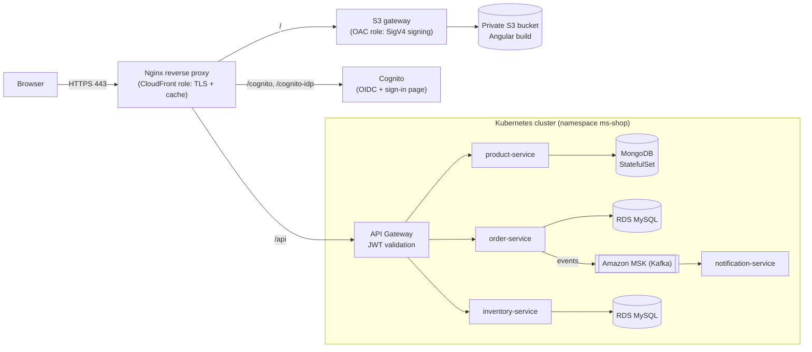

# Cloud-Native Microservices Shop on AWS (EKS, RDS, MSK, Cognito)

An e-commerce platform built from an Angular storefront and Spring Boot microservices running on Kubernetes (Amazon EKS).
All infrastructure is described with **Terraform**. The AWS services run locally on an emulator, so the whole stack runs
on a laptop with Docker.

> ## Requirement: Floci
>
> This project runs on **Floci**, a free, open-source AWS emulator that runs in Docker.
> **Install and start Floci first:** https://github.com/floci-io/floci
>
> Every Terraform file and AWS command below targets Floci's local endpoint (`http://localhost:4566`), not a real AWS account.

## Contents

1. [Architecture](#architecture)
2. [Repository layout](#repository-layout)
3. [Prerequisites](#prerequisites)
4. [Build the project](#build-the-project)
5. [Verify](#verify)
6. [Restart after Floci was restarted](#restart-after-floci-was-restarted)
7. [Links](#links)

## Architecture



| Layer | Component | Role |
|---|---|---|
| Edge | Nginx reverse proxy | Plays the CloudFront role: HTTPS, HTTP to HTTPS redirect, caching of static files, routing |
| Edge | S3 gateway | Plays the Origin Access Control role: signs requests (SigV4) so the bucket stays private |
| Storage | S3 bucket `ms-shop-frontend` | Hosts the Angular build, no public access |
| Identity | Amazon Cognito | User pool and app client, OIDC authorization code flow with PKCE |
| Entry point | API Gateway (Spring Cloud Gateway, port 9000) | Only service exposed outside the cluster, validates JWTs |
| Services | product (8084), order (8081), inventory (8082), notification (8083) | Spring Boot microservices on `ClusterIP` services |
| Data | MongoDB (StatefulSet), two RDS MySQL instances | One database per service |
| Messaging | Amazon MSK (Kafka) | Order events consumed by the notification service |
| Images | Amazon ECR | One repository per service (`ms-shop/<service>`) |

**Tech stack:** Terraform, Amazon EKS, RDS (MySQL 8.0), MSK, S3, Cognito, ECR, Docker, Kubernetes, Java 21, Spring Boot 3,
Spring Cloud Gateway, Kafka, MongoDB, Angular, Nginx, Floci.

## Repository layout

Adjust the paths to match your repository.

```
.
├── frontend/                      # Angular application
├── Clean-Terraform-Folder/
│   ├── bootstrap-terraform/       # state bucket + lock table (local state)
│   └── infra-terraform/           # VPC, RDS, MSK, EKS, Cognito, ECR, S3
├── k8s/
│   └── EKS/                       # Kubernetes manifests, one file per service
│       ├── api-gateway.yaml
│       ├── product-service.yaml   # includes the MongoDB StatefulSet
│       ├── order-service.yaml
│       ├── inventory-service.yaml
│       └── notification-service.yaml
├── nginx/
│   ├── nginx.conf                 # CDN-role reverse proxy
│   └── certs/                     # self-signed certificate (not committed)
├── docker-compose.yml             # Nginx + S3 gateway
├── api-gateway/  product-service/  order-service/  inventory-service/  notification-service/
```

## Prerequisites

Install these tools and check them:

```powershell
docker --version
terraform version
kubectl version --client
java -version        # Java 21
mvn -v
node -v              # Node.js 20 or later
npm install -g @angular/cli
ng version
```

Give Docker Desktop **8 GB of memory or more** (Settings, Resources): Floci, two MySQL instances, Kafka and the cluster do
not fit comfortably in 5 GB.

Add the host name to your `hosts` file (run PowerShell as administrator):

```powershell
Add-Content C:\Windows\System32\drivers\etc\hosts "127.0.0.1 www.websitetemplate.test"
```

Create the self-signed certificate (the `nginx/certs` folder must not be committed):

```powershell
mkdir nginx\certs
docker run --rm -v "${PWD}\nginx\certs:/certs" alpine/openssl req -x509 -nodes -days 365 -newkey rsa:2048 `
  -keyout /certs/server.key -out /certs/server.crt -subj "/CN=www.websitetemplate.test" `
  -addext "subjectAltName=DNS:www.websitetemplate.test,DNS:localhost"
```

Add these entries to `.gitignore`: `*.tfstate*`, `.terraform/`, `terraform.tfvars`, `nginx/certs/`, `.env`, `*.tar`, kubeconfig files.

## Build the project

All commands are PowerShell, run from the repository root unless stated otherwise.

### 1. Start Floci

Follow the instructions in the Floci repository: https://github.com/floci-io/floci

Floci exposes the AWS API on port `4566` and a container registry on port `5100`. Check that it runs:

```powershell
docker ps --format "table {{.Names}}\t{{.Ports}}"
```

You should see a Floci container publishing `4566`. Then define a helper that runs the AWS CLI in Docker against Floci
(repeat this in every new terminal; no AWS CLI installation is needed):

```powershell
function awsl { docker run --rm -e AWS_ACCESS_KEY_ID=test -e AWS_SECRET_ACCESS_KEY=test -e AWS_DEFAULT_REGION=us-east-1 amazon/aws-cli --endpoint-url http://host.docker.internal:4566 @args }
awsl s3 ls
```

The second command must succeed (an empty list is fine). Always target Floci with `--endpoint-url`: a command without it
goes to the real AWS.

### 2. Create the Terraform state backend

`bootstrap-terraform` creates the S3 bucket that stores the Terraform state and the DynamoDB table used for locking.
It keeps its own state **locally**: it creates the bucket the other projects use as their backend.

```powershell
cd Clean-Terraform-Folder\bootstrap-terraform
terraform init
terraform apply
awsl s3 ls
```

You should see `mon-tfstate-bucket`.

### 3. Provision the infrastructure

Create `Clean-Terraform-Folder\infra-terraform\terraform.tfvars` (never commit it) with the three database passwords.
Use letters, digits and `-` only:

```hcl
order_db_password     = "ChangeMe-Order-123"
inventory_db_password = "ChangeMe-Inventory-123"
product_db_password   = "ChangeMe-Product-123"
```

```powershell
cd ..\infra-terraform
terraform init
terraform fmt
terraform validate
terraform apply
terraform output
```

Terraform creates the VPC and subnets, two RDS MySQL instances, the MSK cluster, the EKS cluster, the Cognito user pool and
client, five ECR repositories, the Secrets Manager secrets and the frontend bucket. The provider is pointed at Floci through
the `endpoints` block of `providers.tf`.

### 4. Point `kubectl` at the cluster

Floci runs the cluster as a container. Find it, copy its kubeconfig out, and use it:

```powershell
$node = docker ps --filter "publish=6443" --format "{{.Names}}" | Select-Object -First 1
docker cp "${node}:/etc/rancher/k3s/k3s.yaml" "$HOME\.kube\floci-config"
$env:KUBECONFIG = "$HOME\.kube\floci-config"
kubectl get nodes
```

The node must be `Ready`. Copy the file with `docker cp`: PowerShell's `>` redirection writes UTF-16, which `kubectl`
cannot read. The kubeconfig contains a private key; do not commit it. Set `$env:KUBECONFIG` again in every new terminal.

### 5. Install a storage provisioner

The local cluster ships without one, so the MongoDB volume would stay `Pending`:

```powershell
kubectl apply -f https://raw.githubusercontent.com/rancher/local-path-provisioner/v0.0.30/deploy/local-path-storage.yaml
kubectl annotate storageclass local-path storageclass.kubernetes.io/is-default-class=true --overwrite
kubectl get storageclass
```

### 6. Build the images and load them into the cluster

Build each service and push it to Floci's registry:

```powershell
foreach ($s in "api-gateway","product-service","order-service","inventory-service","notification-service") {
  docker build -t "localhost:5100/ms-shop/${s}:1.0" ".\$s"
  docker push "localhost:5100/ms-shop/${s}:1.0"
}
```

This assumes a `Dockerfile` in each service folder. If a service builds its image with Spring Boot buildpacks instead,
use `mvn -pl <service> spring-boot:build-image -DskipTests -Dspring-boot.build-image.imageName=localhost:5100/ms-shop/<service>:1.0`.

The cluster node cannot pull from the emulated ECR (the emulator routes registry requests by host name), so import the
images straight into the node's containerd:

```powershell
$ecr = "000000000000.dkr.ecr.us-east-1.localhost:4566/ms-shop"
foreach ($s in "api-gateway","product-service","order-service","inventory-service","notification-service") {
  docker tag  "localhost:5100/ms-shop/${s}:1.0" "$ecr/${s}:1.0"
  docker save "$ecr/${s}:1.0" -o "$s.tar"
  docker cp   "$s.tar" "${node}:/tmp/$s.tar"
  docker exec $node ctr --address /run/k3s/containerd/containerd.sock -n k8s.io images import "/tmp/$s.tar"
}
Remove-Item *.tar
```

The manifests reference the `$ecr/<service>:1.0` names with `imagePullPolicy: IfNotPresent`, so Kubernetes uses the imported images.

### 7. Gather the configuration values

The manifests contain values that depend on your infrastructure. Collect them and put each one where the table says.

```powershell
cd Clean-Terraform-Folder\infra-terraform
terraform output
awsl rds describe-db-instances --query "DBInstances[].[DBInstanceIdentifier,Endpoint.Address,Endpoint.Port]" --output table
```

Create a Cognito test user, get a token, and read the token's issuer:

```powershell
$pool   = terraform output -raw cognito_user_pool_id
$client = terraform output -raw cognito_client_id

awsl cognito-idp admin-create-user --user-pool-id $pool --username test@example.com --user-attributes Name=email,Value=test@example.com Name=email_verified,Value=true --message-action SUPPRESS
awsl cognito-idp admin-set-user-password --user-pool-id $pool --username test@example.com --password "Test-1234" --permanent
awsl cognito-idp admin-add-user-to-group --user-pool-id $pool --username test@example.com --group-name user

$auth  = awsl cognito-idp initiate-auth --auth-flow USER_PASSWORD_AUTH --client-id $client --auth-parameters "USERNAME=test@example.com,PASSWORD=Test-1234" | Out-String | ConvertFrom-Json
$token = $auth.AuthenticationResult.AccessToken

$p = $token.Split('.')[1].Replace('-','+').Replace('_','/')
switch ($p.Length % 4) { 2 { $p += '==' } 3 { $p += '=' } }
$claims = [Text.Encoding]::UTF8.GetString([Convert]::FromBase64String($p)) | ConvertFrom-Json
$claims.iss
$claims.'cognito:groups'
```

| Value | Where it comes from | Where to put it |
|---|---|---|
| RDS endpoint and port (order, inventory) | `terraform output order_db_endpoint` and `inventory_db_endpoint`, and the port from `awsl rds describe-db-instances` | The datasource URL in `order-service.yaml` and `inventory-service.yaml` |
| Database user and password | The names and `terraform.tfvars` values from step 3 | The same two manifests (Secrets) |
| Kafka bootstrap servers | `terraform output kafka_bootstrap_servers` | `SPRING_KAFKA_BOOTSTRAPSERVERS` in `order-service.yaml` and `notification-service.yaml` |
| JWT issuer | `$claims.iss`: must equal the `iss` claim of the tokens exactly | `..._JWT_ISSUERURI` in `api-gateway.yaml` |
| JWKS address | `<iss>/.well-known/jwks.json`, using a host name the pods can reach (pods cannot use `localhost`; for example `host.docker.internal`) | `..._JWT_JWKSETURI` in `api-gateway.yaml` |
| Cognito client id | `terraform output -raw cognito_client_id` | `clientId` in the Angular `auth.config.ts` (step 11) |

Order and notification services were originally configured with a Confluent Schema Registry, which MSK does not provide:
deploy a Schema Registry in the cluster, or switch those two services to JSON serialization.

### 8. Deploy the services

```powershell
cd ..\..
kubectl create namespace ms-shop
kubectl apply -f k8s/EKS/product-service.yaml
kubectl apply -f k8s/EKS/inventory-service.yaml
kubectl apply -f k8s/EKS/order-service.yaml
kubectl apply -f k8s/EKS/notification-service.yaml
kubectl apply -f k8s/EKS/api-gateway.yaml
kubectl get pods,svc -n ms-shop -w
```

Create the namespace in its own step: deleting a file that also defines it would delete everything inside it.
Wait until every pod is `Running` and `Ready`. The gateway Service is a `NodePort` on `30900`; it is the only entry point.

If a pod does not start, read why:

```powershell
kubectl describe pod -n ms-shop <pod-name>
kubectl logs -n ms-shop deploy/<service-name>
```

### 9. Start the edge layer (Nginx + S3 gateway)

Write the `.env` file that tells Docker Compose which Floci container and network to use:

```powershell
$floci = docker ps --filter "publish=4566" --format "{{.Names}}" | Select-Object -First 1
$net   = (docker inspect $floci --format '{{range $n, $v := .NetworkSettings.Networks}}{{$n}} {{end}}').Trim().Split(' ')[0]

@("BUCKET_NAME=ms-shop-frontend",
  "AWS_ACCESS_KEY_ID=test",
  "AWS_SECRET_ACCESS_KEY=test",
  "AWS_REGION=us-east-1",
  "FLOCI_NETWORK=$net",
  "FLOCI_HOST=$floci") | Set-Content .env -Encoding ascii

docker compose up -d
docker compose ps
```

Nginx and the S3 gateway join the Floci Docker network, so they can reach the Kubernetes node (NodePort `30900`) and the
emulated S3. Nginx serves the site over HTTPS, sends `/` to S3, `/api/` to the gateway and never caches `/api/`.

### 10. Configure the frontend

In `frontend/src/app/.../auth.config.ts`, set the OIDC values (the path may differ in your tree):

```typescript
export const authConfig: PassedInitialConfig = {
  config: {
    authority: '<issuer from step 7, as exposed by the Nginx /cognito route>',
    clientId: '<terraform output -raw cognito_client_id>',
    scope: 'openid profile email',
    responseType: 'code',
    redirectUrl: window.location.origin,
    postLogoutRedirectUri: window.location.origin,
    silentRenew: true,
    useRefreshToken: true,
  }
};
```

- Do not request `offline_access`: Cognito does not support it.
- The API base URL is the relative path `/api`, so one build works behind any host name.
- The user name is the e-mail: read the `email` claim, not `preferred_username`.
- The Cognito client allows `https://www.websitetemplate.test` as redirect and logout URI (`cognito.tf`). If you use another
  host name, add it to `callback_urls` and `logout_urls` (exact value, no wildcard) and run `terraform apply` again.

### 11. Build the frontend and publish it to S3

```powershell
cd frontend
npm install
ng build --configuration production
docker run --rm -v "${PWD}/dist/frontend/browser:/dist" --network $net `
  -e AWS_ACCESS_KEY_ID=test -e AWS_SECRET_ACCESS_KEY=test -e AWS_DEFAULT_REGION=us-east-1 `
  amazon/aws-cli s3 sync /dist s3://ms-shop-frontend --delete --endpoint-url "http://${floci}:4566"
cd ..
```

The build folder is `dist/<project-name>/browser`; check `outputPath` in `angular.json` if yours differs.
Check the upload:

```powershell
awsl s3 ls s3://ms-shop-frontend --recursive
```

### 12. Open the site

Browse to `https://www.websitetemplate.test` and accept the self-signed certificate warning. Sign in with
`test@example.com` / `Test-1234`, or any user created in the Cognito user pool.

## Verify

| Check | Command | Expected |
|---|---|---|
| Pods | `kubectl get pods -n ms-shop` | Every pod `Running` and `Ready` |
| Site | `curl.exe -k -I https://www.websitetemplate.test/` | `200` |
| Single-page routes | `curl.exe -k -I https://www.websitetemplate.test/products` | `200` |
| API without a token | `curl.exe -k -i https://www.websitetemplate.test/api/product` | `401` |
| API with a token | `curl.exe -k -H "Authorization: Bearer $token" https://www.websitetemplate.test/api/product` | `200` and a JSON list |

Add a product and its stock to place a first order. Insert a product in MongoDB:

```powershell
kubectl exec -n ms-shop statefulset/mongodb -- mongosh -u root -p '<mongodb password>' --authenticationDatabase admin product-service --eval 'db.product.insertOne({name:"iPhone 15 Black 128GB",description:"Apple iPhone 15, 128GB, Black",skuCode:"IPHONE-15-BLACK-128GB",price:1299.99})'
```

Then add a stock row with the same `skuCode` in the inventory database (table and column names depend on your entity).

## Restart after Floci was restarted

Floci keeps its data in memory. After a restart, the Terraform state bucket, the infrastructure and the cluster node are
recreated empty, so repeat these steps:

```powershell
# 1. State backend
cd Clean-Terraform-Folder\bootstrap-terraform
terraform apply

# 2. Infrastructure
cd ..\infra-terraform
terraform init -reconfigure
terraform apply

# 3. kubeconfig (the node is new)
$node = docker ps --filter "publish=6443" --format "{{.Names}}" | Select-Object -First 1
docker cp "${node}:/etc/rancher/k3s/k3s.yaml" "$HOME\.kube\floci-config"
$env:KUBECONFIG = "$HOME\.kube\floci-config"
```

Then run step 5 (storage provisioner), the image import of step 6 (images must be imported again, no rebuild is needed
if they are still in Docker), step 7 to refresh the configuration values (the RDS endpoints and the Cognito ids change),
step 8 (services), and step 11 (frontend upload). If Terraform reports a stale state lock, run `terraform force-unlock <ID>`
after making sure no `apply` is still running.

## Links

- Live website: _to be added_
- Demo video: _to be added_
- LinkedIn post: _to be added_

## Author

_Your name_ · [GitHub](https://github.com/) · [LinkedIn](https://www.linkedin.com/)